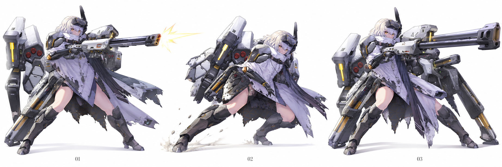
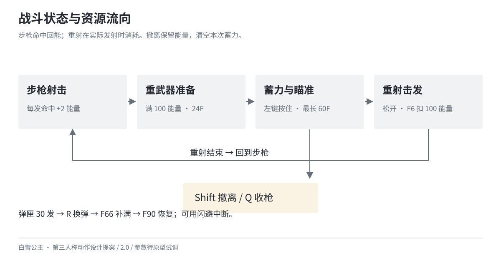
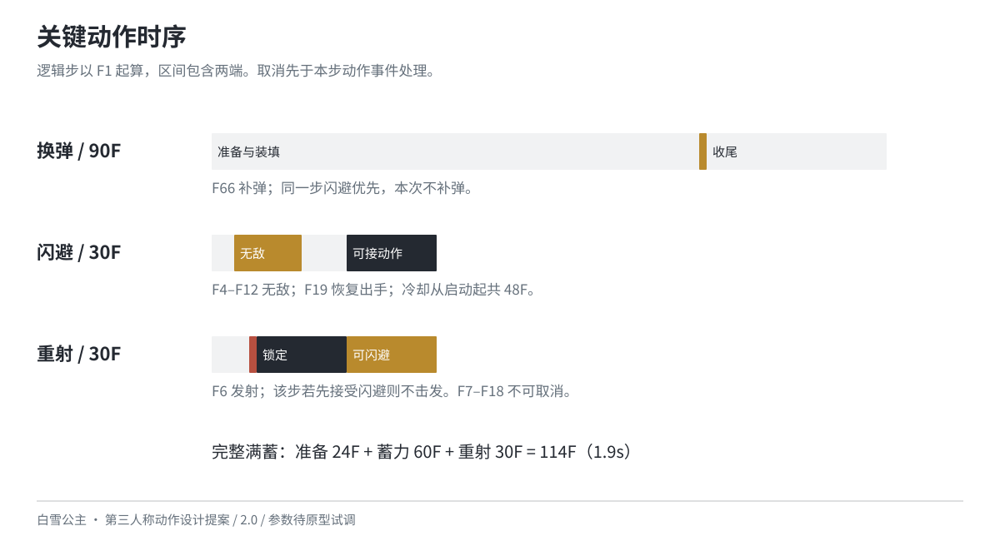

# 白雪公主：第三人称动作设计提案

以《胜利女神：NIKKE》白雪公主为原型，围绕步枪射击与蓄力重火力，设计自由移动、闪避、近身打断和武器切换。玩家以步枪命中积累能量，观察敌人预警与站位，选择提前击发、继续蓄力或撤离。

**当前版本 V2.0，2026-10-26 开始重构，2026-10-27 完成交付整理。** 这是个人作品的非官方设计提案，使用 AI 辅助重构文档与制作概念图。没有引擎原型、3D 模型或动画成品；参数是试调初值，34 个游戏功能用例均待执行。

图为 NIKKE Wiki 原画参考再创作的非官方概念图，不代表已完成模型、动画或机械结构设计。

## 阅读与下载

Notion 项目页：

[https://app.notion.com/p/406ac2aa140381e0b7acfb0e92625d18](https://app.notion.com/p/406ac2aa140381e0b7acfb0e92625d18)

完整策划提案（17 页 PDF）：

[https://github.com/yukidrift2358-oss/nikke-snow-white-action-design/blob/main/output/pdf/白雪公主_动作设计提案_V2.0.pdf](https://github.com/yukidrift2358-oss/nikke-snow-white-action-design/blob/main/output/pdf/白雪公主_动作设计提案_V2.0.pdf)

动作参数与验证工作簿（XLSX）：

[https://github.com/yukidrift2358-oss/nikke-snow-white-action-design/blob/main/output/白雪公主_动作参数与验证_V2.0.xlsx](https://github.com/yukidrift2358-oss/nikke-snow-white-action-design/blob/main/output/白雪公主_动作参数与验证_V2.0.xlsx)

正文源文件位于 `docs/`，按角色定位、操作资源、动作衔接、命中状态、镜头表现、敌人验证、参数依据、重构参考的顺序阅读。`output/` 另有可离线阅读的 HTML；下载仓库后打开，图片从 `assets/` 读取。

## 设计重点

- **武器切换**：步枪有效命中回能；满能后准备重武器，按住左键蓄力、松开击发。能量在实际发射时消耗，提前撤离保留能量并清空蓄力。
- **动作衔接**：统一 60 Hz 时间口径，明确每个动作的发射、补弹、无敌与取消区间；说明补弹和闪避同一步发生时的处理顺序。
- **命中判定**：从实际枪口检查遮挡，按攻击实例与目标去重；贯穿同一敌人的多个部位不会重复结算。
- **敌人与验证**：用远程兵、近战兵和装甲兵分别检查侧移、近击与蓄力时机。训练场、输入边界和异常用例用于后续原型验证。

## 参数与交付

`data/design.json` 统一维护 10 个动作、37 项一般参数、3 类测试敌人和 34 个待执行用例；对应导出动作、参数、敌人和用例 CSV。工作簿包含参数、动作、试算、敌人、用例五页；试算可调整蓄力时间，计算提前击发与满蓄伤害。

已检查参数关系、CSV 与源数据一致性、工作簿公式、PDF 内容与分页，以及旧文件保留情况。蓄力试算核对了 0F、30F、60F 和超过上限的输入。这些检查不等于游戏功能、玩家体验或性能验证，详细范围见 `output/文档校验记录.json`。

## 旧版与参考

旧文件完整保存在 `archive/v1/`，共 161 个旧文件核对为内容不变。旧版的五段射击连招、人格 Buff、自动炮台、固定骨骼/表情数量、性能红线与上线运维表不再作为当前执行规格。具体取舍与旧稿矛盾记录在 `docs/08-重构记录与参考.md`。

角色资料核对自 NIKKE 官网和 Wiki；战斗设计参考《战神》开发讲稿与女武神设计案例，配表结构参考 Epic DataTable 文档。完整来源及采用范围见第 8 章。原作角色与原画权利归原权利方，新姿势图为非官方概念再创作。
