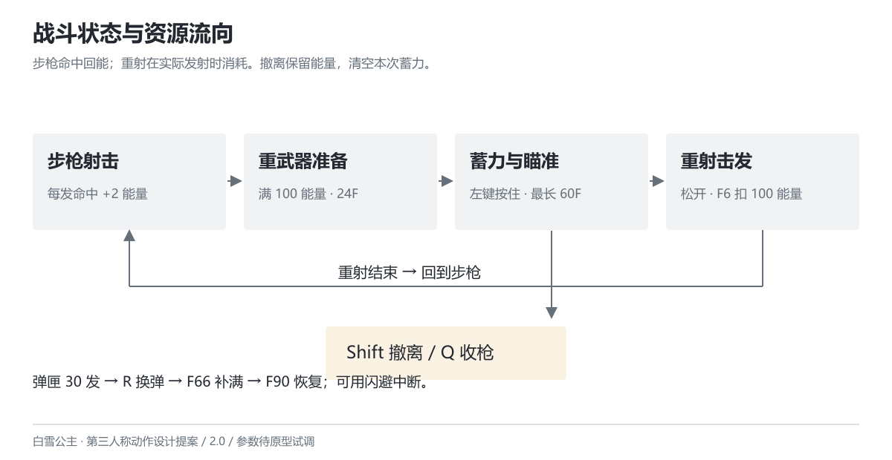

# 操作与资源

版本 2.0 · 2026-10-26 · 设计提案

## 键鼠操作

| 输入 | 步枪状态 | 重武器状态 |
| --- | --- | --- |
| WASD / 鼠标 | 移动 / 调整视角 | 低速移动 / 调整视角 |
| 左键 | 点按一发；按住连续射击 | 按下开始蓄力；松开提交击发 |
| 右键 | 按住肩后精瞄，松开退出 | 不额外缩放，保留肩后视角 |
| Q | 能量满时进入重武器准备 | 未提交击发时退出并清空蓄力 |
| Shift + 方向 | 闪避；无方向时沿当前后方 | 同左，并退出重武器状态 |
| R | 弹匣未满时换弹 | 不记录，界面提示“退出重武器后换弹” |
| F | 枪托近击 | 不记录，避免与蓄力操作混用 |

右键是持续状态，不占输入队列。连续射击读取当前左键按住状态，不缓存多次射击。进入重武器时若左键已经按住，需要先松开再按下，避免把持续射击的松键误判为重射。

## 弹药与能量

步枪弹匣容量暂定 30 发，备弹不限；每次实际击发消耗 1 发，未击发的取消动作不消耗。弹匣为零时，步枪状态下新按左键或持续按住左键均申请换弹；退出受击或闪避后重新检查当前按键，死亡和暂停时不执行。满弹按 R 无动作。

步枪每个攻击实例首次造成正伤害时获得 2 点能量，最高 100。未命中、完全被场景遮挡或无敌目标不回能；同一发命中多个部位仍只回能一次。近击与重射不回能；击杀不额外回能，脱战不自动增长或衰减。

进入重武器要求能量达到 100，但准备与蓄力期间不扣除。发射事件发生时，能量扣除 100 与生成射线在同一步完成。取消、受击、死亡发生在发射事件之前时不扣除；发射之后即使未命中也不返还。满蓄不是免费追加一发，也不回复生命或弹药。

## 生命与受击

训练场角色生命暂定 100。生命归零立即进入死亡，清空输入与尚未执行的攻击事件。普通受击硬直初值 18F，结束前不接受攻击，末 6F 可记录一次闪避。受击后保护 30F，从受击发生的逻辑步开始计时；保护期间不再次扣血或刷新保护，避免重复碰撞延长无敌。它是防止连续命中失控的试调项，不能替代敌人预警。

## 换弹与闪避的代价

换弹总长 90F，F66 补满弹匣。任何时刻可以用合法闪避中断；若闪避与 F66 补弹同一步满足条件，先处理闪避，本次不补弹。F66 已完成之后再闪避则保留已补弹药。重新换弹从 F1 开始，不继承进度。

闪避总长 30F，F4–F12 为无敌段，F19 起可以射击、近击或换弹。48F 冷却从闪避开始计时，取消后摇不重置冷却。闪避距离初值 3m；受场景碰撞限制，不穿墙、不越过阻挡。连续闪避不能覆盖全部冷却时间。

## 一轮操作示例

玩家射击近处轻型敌人，命中获得能量；远程敌人的瞄准线亮起时，侧移或闪避到掩体后。能量满后，等装甲敌人攻击结束、弱点暴露，再按 Q 准备重武器；长按左键蓄力。若近战敌人靠近，可松开提前击发，也可闪避撤离并保留能量。重射发生后回到步枪状态，重新处理弹匣与站位。
