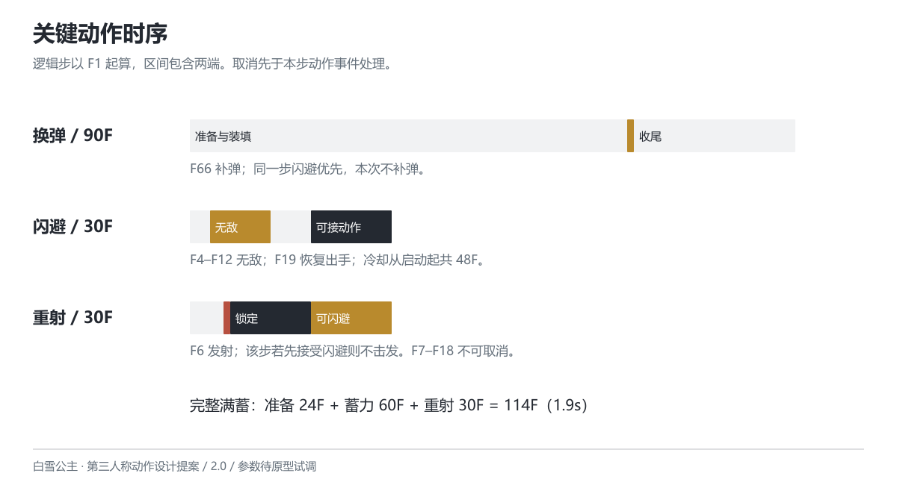

# 动作时序与衔接

版本 2.0 · 2026-10-26 · 设计提案

## 时间口径

本提案使用 60 Hz 逻辑步，每步约 16.67ms。动作编号从 F1 开始，区间包含两端；如 F4–F12 共 9F。进入状态后的第一步记作 F1。可变渲染帧率不改变逻辑时序，暂停不推进动作计时。动画可以重定时，伤害事件不得因为播放速度或过渡重复执行。

动作表描述最小可测规则。每个动作给出总长、事件与可中断起点；不再用含义不清的“Early 20F / Late 14F”表示取消窗口。可进入某动作还必须满足其资源、冷却和输入条件。

## 步枪射击

A_FIRE 总长 12F，F3 发射一发命中扫描射线，伤害初值 10。左右武器可以交替播放枪口表现，但一次发射事件只对应一发弹药和一个攻击实例。F4 起允许闪避；F12 结束后若左键仍按住且有弹药，进入下一次射击。左键松开不撤销已开始的一发。

精瞄过渡 12F，移动速度初值从 5m/s 降到 3.5m/s。精瞄不改变伤害或射速；原型首轮不加入随机散布，先验证准星、遮挡与命中一致性，之后再讨论后坐和扩散。不要用临时的散布优势掩盖射线错误。

## 重武器准备、蓄力和击发

A_ENTER 总长 24F，未完成前不受理重射输入，可用闪避中断。F24 完成后进入 A_CHARGE 等待态。左键按下开始从 0 累加蓄力逻辑步，每完成一步增加 1，最高 60；未按左键时保持零蓄力等待，不自动开火。按 Q 退出为 A_EXIT（18F），回到步枪。

左键松开时锁定当前蓄力值，进入 A_HEAVY_FIRE。伤害 = 80 + 160 × min(蓄力步数,60)/60；未积满一步即松开也按 80 计算。松开后不再增长。击发动作总长 30F，F6 发射，F19 起允许闪避，结束后自动回到步枪；不提供重射连发。

重武器准备和蓄力都没有无敌或霸体。准备、等待、蓄力时移动速度初值为 1.5m/s；重射 F1–F18 原地支撑，F19 起恢复步枪移动。击发前可闪避取消而保留能量；发射之后取消只缩短后摇，不追回已经提交的伤害。原型不采用三次镜头切换、自动弱点锁定或长时间全局停帧。

## 枪托近击

A_MELEE 总长 36F，F13–F15 扫掠近击体，F20 起可闪避。初值伤害 5、作用距离 1.8m、水平前向夹角 ±45°。以角色胸前为起点扫掠，场景阻挡优先；同一动作每个目标只命中一次。轻型敌人受击硬直 24F、后推 1.5m，碰墙停止。装甲敌人未露弱点时不被打断；Boss 不在本轮范围，不能默认所有敌人都会被击退。

近击承担近身打断，伤害低且不回能。它不替代闪避，不附带射击派生，也不需要先完成三段普攻。若原型发现始终没有使用价值，应先检查敌人近身预警和击退效果，再决定是否保留，不能预先宣称“使用率偏低”。

## 中断与状态迁移

| 当前动作 | 可接受的新动作与起点 | 自然结束 |
| --- | --- | --- |
| 步枪待机/移动 | 射击、近击、换弹、Q、闪避；各自检查条件 | 保持步枪 |
| A_FIRE | F4起闪避或Q；F12结束后近击/换弹/下一发 | 回到步枪或继续射击 |
| A_RELOAD | F1起闪避，其他动作不打断 | F90后回到步枪 |
| A_MELEE | F20起闪避 | F36后回到步枪 |
| A_ENTER | F1起闪避 | F24后进入重武器等待 |
| A_CHARGE | 任意步闪避、Q退出，或松键提交重射 | 无自然结束 |
| A_HEAVY_FIRE | F1–F6或F19–F30可闪避；F6同一步先裁决取消；F7–F18锁定 | F30后回到步枪 |
| A_EXIT | F1起闪避 | F18后回到步枪 |
| A_DODGE | F19起射击、近击、换弹；不提前接Q | F30后回到步枪 |
| A_HIT | 末6F只记录闪避，F18结束后才执行 | 回到步枪 |
| A_DEAD | 不接受战斗输入 | 仅允许重开 |

未列出的迁移不执行；处于无敌或受击保护时先检查能否受伤。死亡可从任意非死亡状态进入。按住射击不会突破换弹、受击或其他锁定段；回到步枪后再读当前按住状态。

## 输入缓冲与同一步裁决

离散输入只保存一个待执行意图，保留 6 个逻辑步（约 100ms）。当前步计为第 1 步，超过第 6 步失效；可执行起点恰好落在第 6 步时执行，第 7 步不执行。新输入覆盖旧意图，同一步多输入按闪避 > Q 切换 > 近击 > 换弹裁决。左键按住和右键按住只读当前状态；重射松键只在 A_CHARGE 中受理，不进入缓冲。

每步顺序：读取输入 → 暂停/死亡与外部受击裁决 → 资源与冷却检查 → 合法中断 → 到期动作事件 → 移动及镜头表现。外部受击与本角色击发事件同一步到来时，受击优先，未发出的攻击撤销。已在前一步发出的攻击不因后续受击消失。

死亡、离开战斗和暂停均清空待执行意图。恢复暂停时重新读取按住状态，重武器左键必须先释放再重新按下。闪避中无敌段拒绝受击事件，保护结束后命中才产生伤害；资源不足、冷却未到或满弹换弹的请求直接拒绝，不保存为待执行意图。输入缓冲只容忍动作衔接的时间差，不自动等待资源或冷却。
