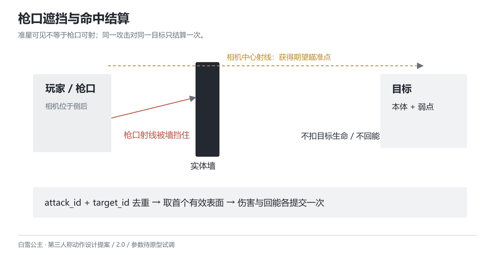

# 命中与状态处理

版本 2.0 · 2026-10-26 · 设计提案

## 射线与遮挡

步枪与重射均以相机中心射线获得期望瞄准点，再从实际枪口向该点查询阻挡。准星指向敌人、枪口却被墙挡住时，只命中墙，在准星旁显示遮挡符号。相机位于墙后也不能绕过枪口遮挡。步枪有效射程初值 30m，重射 60m；射程之外不造成伤害。

重射沿同一射线依次处理最近的有效目标，最多贯穿 3 个不同目标；场景实体墙阻断后续穿透。首轮不穿透场景，不做跳弹、自动索敌和远处范围爆炸。重射的细束与命中火花用来指出实际路径，不用覆盖屏幕的爆炸掩盖落点。

## 部位与重复结算

角色先使用一个移动碰撞胶囊与一个伤害接收体。敌人先区分本体与一个可选弱点，不预设 43 个判定体。移动碰撞负责场景阻挡，伤害接收体负责战斗命中，两者不混用。

每次攻击生成唯一 attack_id；去重键为 attack_id + target_id。同一攻击命中目标多个部位，取距离最近的有效表面；重合距离时弱点优先，一次只结算一份伤害。重射贯穿同一敌人的多个部位仍算一个目标，并且只占一个穿透名额；不能穿过身体后再次取弱点加一份伤害。

普通敌人弱点倍率初值 1.5。装甲目标的封闭本体倍率 0.5，暴露弱点倍率 1.5，两者按实际命中区域选一，不相乘。最终伤害 = 攻击基础伤害 × 目标命中区域倍率；训练场生命可保留小数，界面仅显示四舍五入数值。无敌、完全阻挡或目标已死亡时不结算伤害和回能。

## 状态职责

步枪待机/移动、射击、换弹、近击、重武器准备、蓄力、重射、退出、闪避、受击和死亡为主要状态。精瞄与移动方向作为状态参数，不把每个方向、每个镜头都扩成一个状态节点。换弹只在步枪状态请求；重射结束、退出或闪避后进入步枪。

进入状态时初始化计时和攻击实例；离开状态时撤销未发生事件、关闭近击体并移除临时特效。一次性事件使用实例内已执行标记，不能仅依赖动画回调。动画回调可通知音效和特效，但弹药消耗、补弹、伤害与能量必须由逻辑事件提交。动画跳播、过渡重入不得补发被取消的攻击。

## 异常处理

目标在击发前死亡：仍按枪口射线处理当前场景，不自动改瞄另一个敌人。目标死亡后本次射线可继续查找后方目标，但死人不占穿透名额。枪口挂点缺失：阻止战斗初始化并显示缺失项，不在角色脚下生成攻击。相机被挤近时仍从真实枪口查阻挡；若枪口落在实体墙内则本次仅显示阻挡反馈。

暂停冻结蓄力、冷却、保护时间与敌人预警；恢复后不补偿过去时间。切出窗口按暂停处理。重开训练场重置生命、弹药、能量、冷却、状态、攻击实例与敌人，不保留上次蓄力。
