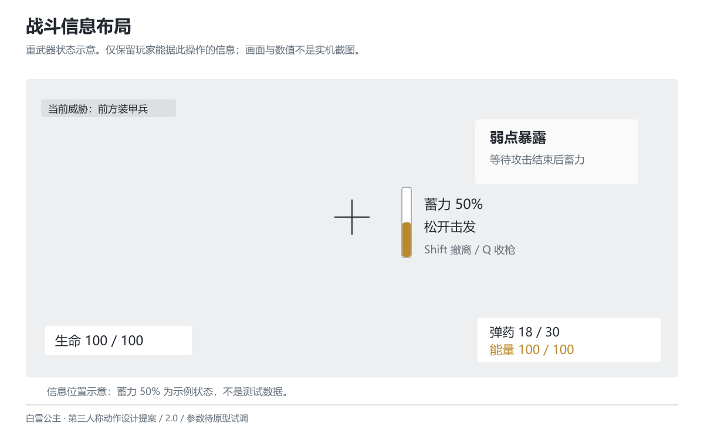

# 镜头、界面与动作表现

版本 2.0 · 2026-10-26 · 设计提案

## 肩后镜头

常态、精瞄、重武器均保持第三人称肩后方向。常态垂直 FOV 初值 65°，精瞄 50°，重武器 45°；屏幕宽高比改变时保持垂直口径。FOV 过渡初值 12F，保留当前朝向，不自动转向目标。它们是试调值，不用 FOV 直接标为“4 倍镜”或“40 倍镜”。

相机先做场景碰撞回缩，再稳定构图。肩位可切换但不移动枪口或绕开掩体；近战和重射不强制切正脸。屏外攻击使用方向符号和独立预警音，不能只靠后方受击后再提示。相机震动可关闭，关闭后蓄力、命中和危险提示仍可辨识。

## 战斗界面

左下仅显示生命，右下显示弹药与能量，中心显示准星及枪口遮挡。重武器状态在准星右侧显示蓄力比例与“松开击发”，下方显示“Shift 撤离 / Q 收枪”。未满能量按 Q 提示“重武器需要 100 能量”，不播放完整切换动作。

保留白灰、深灰和少量暖黄。能量满用刻度闭合与文字提示，蓄力满用边框闭合和一次短促音效；危险用橙红符号并配方向，避免仅靠颜色传达。移除风速、无弹道作用的测距、人格层数和重复的枪械读数。UI 图仅展示信息位置，不声称是实机截图。

## 关键姿势与动画需求

步枪开火：角色看向目标，武器轴线清楚，左右模块不能遮住准星。移动时下肢保持方向变化，上身保持瞄准；不要先锁死逐关节角度再要求动画匹配。闪避：武器先收近身体，角色沿输入方向跨步，披风延后跟随，枪口不从身体或地面穿出。

重武器准备：先让武器进入可见支撑位，再完成据枪；蓄力时膝髋承重，击发后先卸力再回正。收枪应能与闪避共用中断姿势，避免大型部件突然消失。具体固定结构、挂点和装填动作需在模型与绑定可用后确认。附图是由 Wiki 原画参考再创作的关键姿势概念图，不是可直接制作的三视图或模型规格。

最小动画清单：持枪待机、前后左右移动与混合、步枪开火上身层、装填、枪托近击、闪避、重武器准备/蓄力循环/击发/收枪、受击与死亡。先检查剪影、支撑、瞄准方向及中断时的接续，再补机械细节。面部仅需观察、蓄力专注、受击与死亡的表情需求，不预设 52 个 Blend Shape 或永久锁定清单。

## 音效与特效

步枪枪口光、枪声与扣弹在同一发射事件触发；命中提示在伤害实际结算后出现。蓄力循环音在满蓄时切为稳定提示，取消时立刻退出；重射使用一次主要冲击音、短促后坐与路径亮束。先不用全局 Hit Stop，避免射击、敌人预警和输入时序被一起冻结。

近击以接触音、目标后退和短促命中火花表现打断；若未打断装甲，则给出硬质碰撞音和“不打断”符号。特效不能超过已定义的命中范围。取消、受击、暂停、死亡都要停止对应的循环音和持续特效。低闪烁选项关闭白闪与色差，保留轮廓和提示音。

## 制作与性能确认

本轮未指定引擎、模型和目标硬件，不发布骨骼数、Draw Call、显存或粒子“红线”。先在选定设备记录场景基线，再分别打开角色、开火、重射和特效，记录帧时间变化及瓶颈。数值预算应由该记录决定。原型先用灰盒武器、基础材质和必要提示，确认玩法后再投入最终资产。
