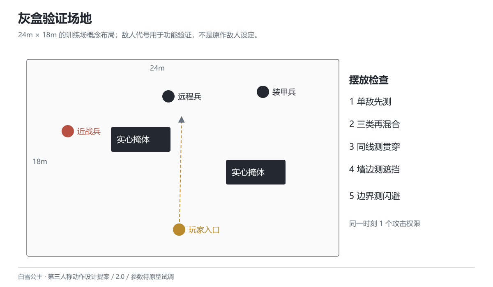

# 敌人与验证场景

版本 2.0 · 2026-10-26 · 设计提案

## 三类测试敌人

敌人以灰盒代号呈现，不将新设计包装成原作莱彻种类。E_RANGED 远程兵初始生命 80，瞄准预警 30F 后朝锁定位置开一发，伤害 10，随后休息 90F。预警结束时锁定落点，之后不继续追踪；地面标记保留到该次攻击结束。玩家可以侧移或利用掩体阻挡。

E_RUSH 近战兵初始生命 60，接近后播放 36F 前摇，F37–F42 向锁定方向冲刺攻击一次，初值伤害 15，后摇 48F。前摇结束时锁定方向，冲刺不追踪转弯，碰墙停止。玩家可侧闪、提前射杀或在接触前枪托打断。攻击实例对玩家只结算一次。

E_ARMOR 装甲兵初始生命 160，本体封闭时伤害倍率 0.5；蓄势 48F 后发射直线攻击，伤害 20，随后恢复 120F，恢复期暴露弱点（倍率 1.5）。玩家可以等弱点暴露再蓄力重射，也可以提前射击削血。未暴露时枪托不能打断。攻击结束事件开启弱点，恢复结束时关闭，不用不同动画版本的时间长度隐式决定。

敌人攻击权限在混合场景初值为 1：一个敌人进入攻击前摇至结束恢复前占用权限；被打断、死亡或目标丢失立即归还。未获权限者只能移动、观察，不造成伤害。屏外敌人先进入可感知位置再申请；这一保守初值先验证预警和操作，再根据记录试调，不能直接宣称“大群压迫感足够”。

## 灰盒场地与摆放

场地初值 24m × 18m，四周封闭，两块实心掩体分开放置，留出横向闪避与直线贯穿路线。角色从长边中央进入；远程兵放在正前方，近战兵从侧前方进入，装甲兵位于远端。下表以场地中心为原点、平面 X 向右、Z 向前，单位为米；示意图不按精确比例施工，也不是实际关卡制作结果。

| 对象 | 中心坐标（X，Z） | 初始设置 |
| --- | --- | --- |
| 玩家 | （0，-6） | 朝向 +Z，生命100、弹药30、能量0 |
| 远程兵 | （-1，6） | 首轮单敌验证；后续混合时保留 |
| 近战兵 | （-9，2.5） | 朝玩家接近 |
| 装甲兵 | （6，6） | 正面朝向玩家入口 |
| 左侧掩体 | （-3.2，1.7） | 宽4.5m、深2.2m、高2.2m |
| 右侧掩体 | （5.6，-1.3） | 宽4.5m、深2.2m、高2.2m |

测试敌人互相站在一条射线上时验证贯穿，不把平时所有敌人都排列成直线。掩体旁安排单独的“相机可见但枪口被挡”位置；边界处检查闪避不会出界或穿墙。

## 测试顺序与要回答的问题

1. 静止靶：射击、弹匣、换弹、回能和取消事件是否一致？
2. 单个远程兵：能否看懂落点并用侧移或掩体规避？
3. 单个近战兵：枪托和闪避是否分别提供可观察的应对收益？
4. 单个装甲兵：玩家是否能识别封闭与露出弱点，完成一次满蓄？
5. 三类混合：是否仍能辨认当前攻击者，主动选择提前击发或撤离？
6. 阻挡与重复事件：墙边、弱点重叠、暂停恢复和目标死亡是否产生错误结算？

## 功能检查与手感观察

data/test_cases.csv 给出明确前置条件、操作和预期结果，初始状态均为“待执行”。文档校验只证明参数引用和时序关系没有发现矛盾，不证明这些用例已经在游戏中通过。

制作原型后，应为每次执行记录构建版本、输入序列、关键帧或日志、实际结果；体验观察另记能否识别预警、为何取消蓄力、为何选近击等行为。不要用没有分母的通过率、预设满意度、虚构平均使用率替代记录。先修复错误命中、失控和丢失输入，再讨论攻击节奏和平衡。
